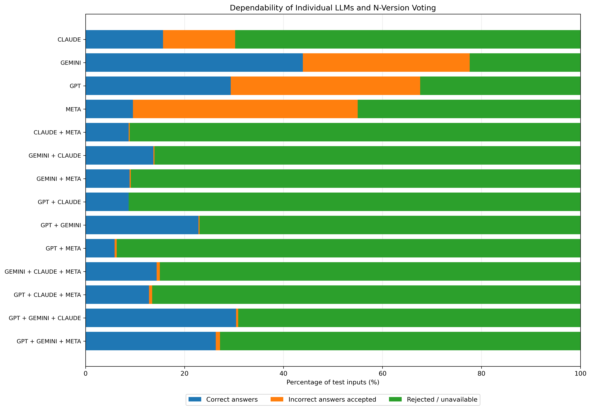
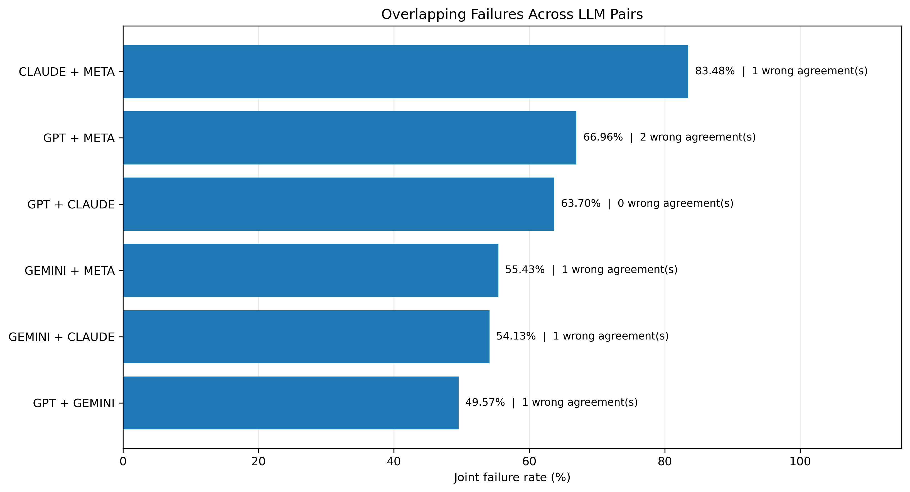

# Design Diversity in LLM-Generated C++ Programs

An empirical evaluation of whether independently generated programs fail on the same inputs and whether N-version output voting improves dependability.

The experiment uses **four LLMs** (GPT, Gemini, Claude, and Meta), **30 ICPC-Eval programming problems**, and **20 test inputs per problem**. The resulting **120 C++ programs** were compiled and executed on **2,400 model–input combinations**. The reported voting analysis covers **23 problems (460 distinct test inputs)** for which the implemented correctness checks were applicable.

## Research questions

1. How frequently do independently generated programs fail on the same test input?
2. How often do different programs produce the **same incorrect output**?
3. Does two-version agreement voting or three-version majority voting reduce incorrect-output acceptance compared with a single LLM-generated program?
4. What is the trade-off between incorrect-output acceptance and correct-answer availability?

## Experimental design

| Component | Configuration |
| --- | --- |
| Benchmark | ICPC-Eval; problem IDs 0–29 |
| Models | GPT, Gemini, Claude, Meta |
| Programs | One C++ solution per model per problem (120 total) |
| Test cases | 20 per problem (600 distinct problem–input cases) |
| Executions | 4 models × 600 cases = 2,400 |
| Language | C++23 |
| Voting configurations | All 6 model pairs; all 4 three-model combinations |
| Analysed subset | 23 problems × 20 inputs = 460 cases per system |

Each program is evaluated against all available test inputs rather than stopping at its first failure. Compilation errors, execution failures, timeouts, and incorrect answers are preserved as separate outcomes. Programs are **not manually fixed** after generation.

### Voting rules

- **Two versions:** Accept an answer only when both programs finish successfully and their outputs agree; otherwise reject it.
- **Three versions:** Accept an answer if at least two of the three programs finish successfully and agree; otherwise reject it.
- **Assessment:** The voter compares program outputs **without accessing the reference answer**. Reference answers are used only afterward to classify an accepted result as correct or incorrect.
- **Output comparison:** Whitespace-token equality for fixed-output tasks; tolerance-based numerical comparison for four floating-point tasks.

## Key results

The following figures are based on **460 test inputs from 23 assessed problems**, not all 30 problems.

| System | Correct answers | Incorrect answers accepted | Rejected / unavailable |
| --- | ---: | ---: | ---: |
| Gemini (individual) | 202 / 460 (43.91%) | 155 / 460 (33.70%) | 103 / 460 (22.39%) |
| GPT (individual) | 135 / 460 (29.35%) | 176 / 460 (38.26%) | 149 / 460 (32.39%) |
| Claude (individual) | 72 / 460 (15.65%) | 67 / 460 (14.57%) | 321 / 460 (69.78%) |
| Meta (individual) | 44 / 460 (9.57%) | 209 / 460 (45.43%) | 207 / 460 (45.00%) |
| GPT + Gemini (2-version) | 105 / 460 (22.83%) | 1 / 460 (0.22%) | 354 / 460 (76.96%) |
| GPT + Gemini + Claude (3-version) | 140 / 460 (30.43%) | 2 / 460 (0.43%) | 318 / 460 (69.13%) |

Among the evaluated combinations, the **GPT + Gemini** pair had the lowest joint failure rate (**49.57%**). The **Claude + Meta** pair had the highest (**83.48%**). Six distinct test inputs exhibited at least one accepted incorrect agreement across the voting configurations.

**Interpretation:** Voting sharply reduced the fraction of inputs on which an incorrect output was accepted, but it also rejected many inputs. The best individual program source, Gemini, delivered more correct answers overall than any voting configuration tested. This experiment therefore does **not** establish a universal improvement in correct-answer availability from voting.

### Figures





The complete 14-system comparison is available in [`results/comparison_all_systems.csv`](results/comparison_all_systems.csv); pairwise failures are in [`results/failure_overlap_summary.csv`](results/failure_overlap_summary.csv).

## Repository structure

```text
.
├── README.md
├── .gitignore
├── solutions/
│   ├── gpt/               # id0.cpp ... id29.cpp
│   ├── gemini/            # id0.cpp ... id29.cpp
│   ├── claude/            # id0.cpp ... id29.cpp
│   └── meta/              # id0.cpp ... id29.cpp
├── scripts/
│   ├── step7_compile_all.py
│   ├── step8_execute_programs.py
│   ├── step12_judge_all.py
│   ├── step13_float_judge.py
│   ├── final_analysis.py
│   ├── dependability_analysis.py
│   ├── three_version_voting.py
│   ├── failure_overlap_summary.py
│   ├── compare_dependability.py
│   └── generate_research_figures.py
├── results/               # Curated CSV results and summaries
└── figures/               # PNG and SVG visualisations
```

The large benchmark file and generated binaries/program outputs are stored locally and are **not** committed to this repository.

## Reproducing the experiment

**Requirements:** Linux or WSL, Python 3, a `g++` toolchain supporting the requested C++ standard, and sufficient disk space for the benchmark and generated outputs. Figure generation also requires `numpy` and `matplotlib`.

1. Obtain the benchmark data from [ICPC-Eval](https://github.com/RUCAIBox/ICPC-Eval) and prepare the same 30-record JSONL subset at `dataset/ICPC_Eval_Dataset/ICPC_Eval_30.jsonl`. Each record must include its problem ID, test cases, and execution limits, as expected by the scripts.
2. Execute these commands from the **repository root**:

```bash
python3 scripts/step7_compile_all.py
python3 scripts/step8_execute_programs.py --all
python3 scripts/step12_judge_all.py
python3 scripts/step13_float_judge.py
python3 scripts/final_analysis.py
python3 scripts/dependability_analysis.py
python3 scripts/three_version_voting.py
python3 scripts/failure_overlap_summary.py
python3 scripts/compare_dependability.py
```

3. To regenerate the figures:

```bash
python3 -m pip install numpy matplotlib
python3 scripts/generate_research_figures.py
```

Execution writes temporary binaries and standard-output captures under `outputs/`. Result tables are written under `results/` and figures under `figures/`. The voting scripts need the recorded standard-output files; to recompute voting from scratch, run compilation and execution first.

## Scope and limitations

- **Constructive-output tasks excluded from the reported voting metrics:** IDs **0, 10, 12, 15, 16, 19, and 21**. They require problem-specific semantic validators. Although the C++ programs were executed, their unvalidated outputs were not treated as correct or incorrect in the final comparison.
- **Floating-point voting** uses tolerance-based agreement. Pairwise numerical closeness is an approximation to voter equivalence and requires care when interpreting majority decisions.
- **Timing:** Execution timeouts were enforced as local wall-clock limits, which can differ from contest CPU-time judging. Observed verdicts can depend on machine load and toolchain.
- **Memory:** Local resource limits do not perfectly replicate the benchmark's execution environment.
- **Test coverage:** Twenty test inputs per problem are not exhaustive. Results reflect the selected dataset and generated programs, not general model performance.
- **Statistical unit:** Inputs within a programming problem are related; the 460 case-level results should not be treated as 460 independent programming tasks.
- **Voting versus oracle selection:** The reported voter never uses reference answers to choose an output. It is not an oracle that selects whichever model happens to be correct.

